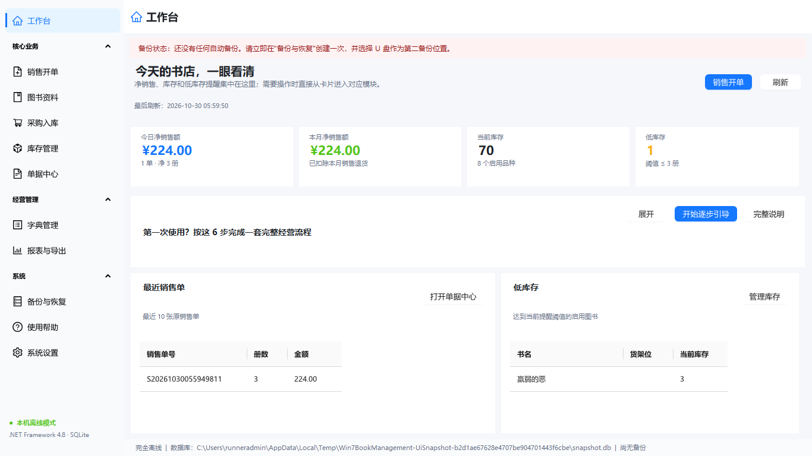
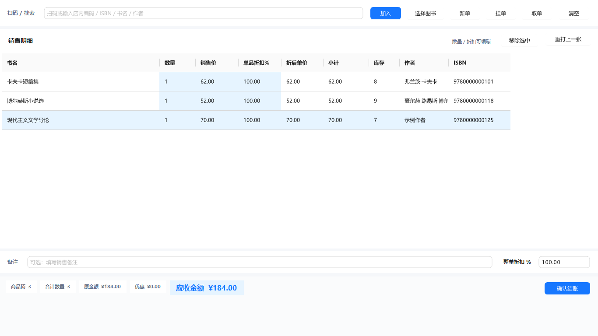
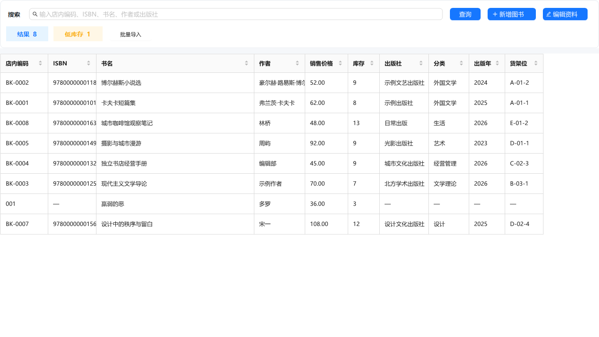
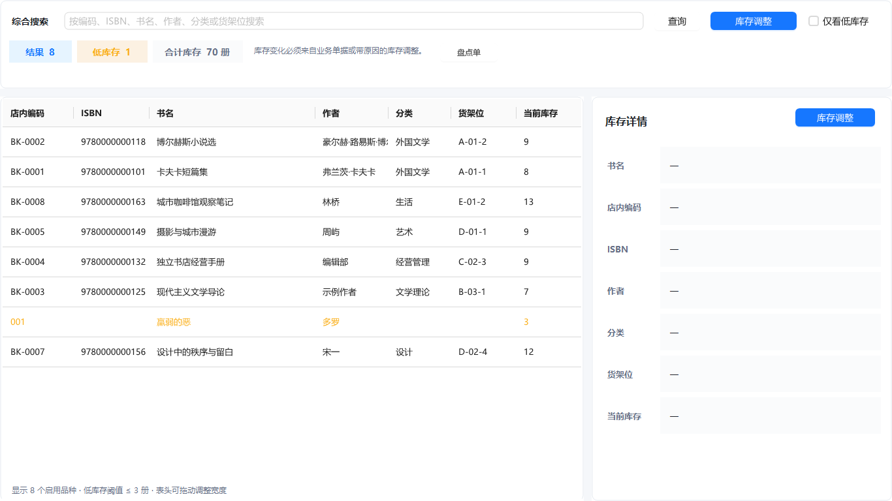
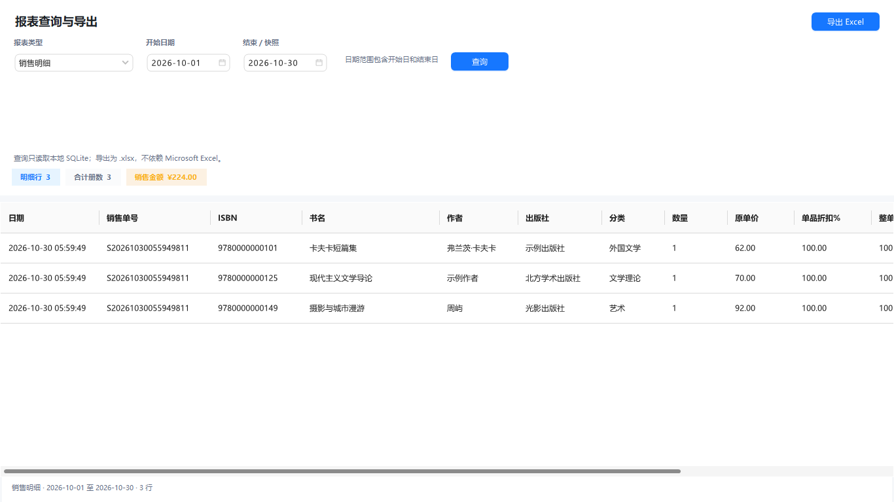
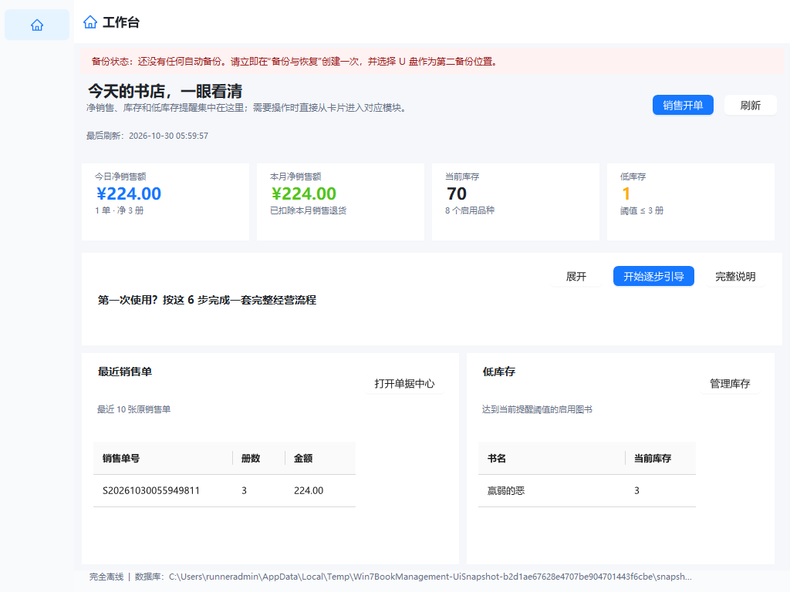

# BOOK DESK · 简易图书管理系统

面向小书店的**完全离线**进销存与收银软件：图书、采购、销售、退货、库存、报表和备份，一台 Windows 7 老电脑也能用。

[下载安装包](https://github.com/BrainEno/win7-book-management/releases/latest) · [真实界面截图（Windows CI）](https://github.com/BrainEno/win7-book-management/actions/workflows/build.yml) · [使用手册](docs/USER_GUIDE.md) · [常见问题](docs/FAQ.md)

## 界面截图（Windows CI 实机渲染）

以下截图由 Windows CI 上的真实 WinForms 界面生成，非设计稿；完整分辨率矩阵见每次构建的 `ui-snapshots` 工件。

| 首页仪表盘 | 销售开单 |
| --- | --- |
|  |  |
| 图书资料 | 库存管理 |
|  |  |
| 报表中心 | 小屏 1024×768 首页 |
|  |  |


## 系统要求

- Windows 7 SP1 或更高，x86 / x64；建议 2 GB 内存，支持 1024×768 与高 DPI。
- Win7 安装 .NET 4.8 前需 **KB4474419、KB4490628**；安装器会检测并提示。安装包内置 .NET 4.8 离线运行时，目标电脑无需联网。
- 不需要 Microsoft Excel 即可生成报表。旧版 Office 打开 .xlsx 需兼容包，详见 FAQ。
- 发布包附 `SHA256SUMS`。未配置签名证书的构建会明确标为未签名；商用分发前应完成代码签名与 [Win7 实机验收](docs/WIN7_SMOKE_TEST.md)。

## 3 分钟上手

1. **图书资料**：逐本录入或批量导入 Excel / CSV 模板；ISBN 自动校验并把 ISBN-10 转为 ISBN-13，无 ISBN 的自出版物也可使用。
2. **采购入库**：选择供应商与图书，保存草稿后点击“确认入库”。
3. **销售开单**：扫码或选书，选择收款方式，确认结账；可打印 / 重打 58/80 mm 小票；退货从原单发起。
4. **库存与报表**：盘点单一次生成调整流水；按日期查询并导出 .xlsx / .xls / CSV 报表。
5. **备份与恢复**：每日首次启动和正常退出会自动备份；在设置页选择 U 盘或另一块硬盘作为第二备份位置。

首次启动有中文引导，之后可在“使用帮助”重新播放。完整操作见 [使用手册](docs/USER_GUIDE.md)。

## 数据安全

- 金额以整数分保存；库存变动、单据和流水在同一事务内提交。
- SQLite WAL + 所有连接统一 `synchronous=FULL`。
- 备份使用 SQLite Backup API，校验完整性、核心表与外键后才发布；第二份备份失败会显示提醒。
- 恢复前自动保存安全快照，失败自动回滚；数据库迁移前也有快照，旧程序拒绝打开更高版本数据库。
- 设置页可验证最近备份、导出诊断 ZIP（不包含数据库）。不要手工复制运行中的 `.db` 文件。

## 开发与构建

技术栈：C# / WinForms / **.NET Framework 4.8** / SQLite / AntdUI 2.4.12 / NPOI 2.6.2 / Inno Setup 6.7.3。

```bat
msbuild Win7BookManagement.sln -restore /m /p:Configuration=Release /p:Platform=x86
build-installer.cmd
```

图标已入库，普通编译不再调用 PowerShell，也不会改写资源。构建脚本对 .NET 离线包和 Inno Setup 强制校验固定 SHA-256；哈希不符即失败。版本唯一来源是 [`VERSION`](VERSION)。

- [开发约定](AGENTS.md) · [贡献与构建说明](CONTRIBUTING.md) · [更新日志](CHANGELOG.md)
- [UI 规范](docs/UI_DESIGN_STANDARD.md) · [Win7 烟测清单](docs/WIN7_SMOKE_TEST.md) · [性能基线](docs/PERFORMANCE.md)
- 生产 EXE 只保留最小冒烟自检；完整业务 / UI 回归与截图工具在独立 `UiTools` 项目，单元测试在 `tests`，均不打入安装包。

GitHub Actions 执行 Debug/Release x86 编译、单元测试、完整自检、UI 截图和离线安装包构建；`v*` 标签发布 Release 与 SHA256SUMS。CI 通过不等于 Win7 实机验收通过。
